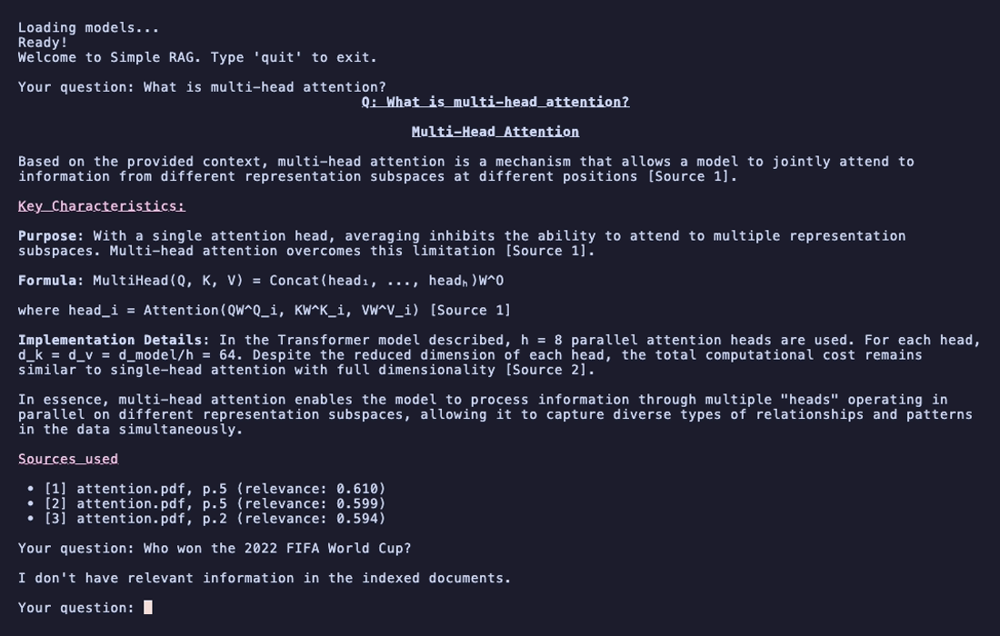

# Simple RAG


A minimal, end-to-end **Retrieval-Augmented Generation** pipeline built from scratch in Python. Ask questions about a corpus of PDF documents and get grounded, source-cited answers from an LLM — without hallucinations.

This is a learning project focused on understanding every piece of a RAG stack: document loading, chunking, embeddings, vector search, threshold filtering, and prompt engineering for grounded generation.

## Demo

<!-- Replace with a real recording. Suggested size: ~800px wide. -->


## Features

- **PDF ingestion** — page-by-page extraction with `pypdf`
- **Three pluggable chunkers** — fixed-size, recursive (LangChain-style hierarchical split), and recursive-clean (separators tuned for PDF artifacts)
- **Local embeddings** via `sentence-transformers` (`all-MiniLM-L6-v2`, 384-dim, normalized)
- **Vector search** with ChromaDB (HNSW index, cosine distance)
- **Optional cross-encoder reranking** — second-stage scoring with `cross-encoder/ms-marco-MiniLM-L-6-v2` over the top-N candidates from dense retrieval
- **Distance threshold filtering** — refuses to answer when nothing relevant is retrieved (anti-hallucination)
- **Source attribution** — every answer cites `[Source N]` with filename, page number, and relevance score
- **Grounded generation** via Anthropic Claude (`claude-haiku-4-5`, `temperature=0`) with a strict system prompt
- **Rich-formatted CLI** with markdown rendering for readable answers
- **Retrieval evaluation framework** — 16-question hand-annotated eval set, computes Precision@K / Recall@K / MRR / refusal accuracy with per-type breakdown

## Architecture

```
                     ┌──── INDEXING (offline) ────┐
  PDFs in data/ ──►  loader ──► chunker ──► embedder ──► ChromaDB
                                                            │
                     ┌──── QUERY (online) ────────┐         │
  user question ──►  embedder ──► retriever ──────┘         │
                                       │                    │
                                       ▼                    │
                                   top-K chunks ◄───────────┘
                                       │
                                       ▼
                                   generator (Claude) ──► cited answer
```

Two phases share the same embedding model and vector store. Indexing is a one-shot batch job; querying is interactive.

## Tech stack

| Layer            | Choice                                  | Why                                              |
|------------------|-----------------------------------------|--------------------------------------------------|
| PDF parsing      | `pypdf`                                 | Pure-Python, no system deps                      |
| Chunking         | Fixed-size + overlap (tunable)          | Selected via measurement — see [Evaluation](#evaluation) |
| Embeddings       | `sentence-transformers/all-MiniLM-L6-v2`| Small (80MB), fast, runs locally on CPU          |
| Vector store     | ChromaDB (persistent)                   | Embedded, no separate server, HNSW out of the box|
| Distance metric  | Cosine                                  | Standard for normalized text embeddings          |
| Reranker (opt.)  | `cross-encoder/ms-marco-MiniLM-L-6-v2`  | MS MARCO standard, ~80MB, big MRR boost          |
| LLM              | Anthropic Claude Haiku                  | Fast, cheap, good instruction-following          |
| CLI rendering    | `rich`                                  | Readable markdown output in the terminal         |

## Quick start

### 1. Clone and install

```bash
git clone https://github.com/<your-username>/simple-rag.git
cd simple-rag
python3 -m venv .venv
source .venv/bin/activate
pip install -r requirements.txt
```

### 2. Configure API key

Copy the example file and fill in your key:

```bash
cp .env.example .env
# then edit .env and paste your real key
```

Get your key at [console.anthropic.com](https://console.anthropic.com/).

### 3. Add documents

Drop any PDF files into `data/`. The repo ships with three example papers:

- `attention.pdf` — *Attention Is All You Need* (Vaswani et al., 2017)
- `bert.pdf` — *BERT: Pre-training of Deep Bidirectional Transformers* (Devlin et al., 2018)
- `rag.pdf` — *Retrieval-Augmented Generation for Knowledge-Intensive NLP Tasks* (Lewis et al., 2020)

### 4. Build the index

```bash
python src/index.py
```

This loads PDFs, chunks them, embeds every chunk, and writes the result to `chroma_db/`. With the three example papers (~50 pages, ~450 chunks for the default `fixed` chunker) it runs in roughly 5 seconds on a laptop CPU.

Optional flags:

```bash
python src/index.py \
    --chunker fixed \
    --chunk-size 500 \
    --overlap 100 \
    --min-chunk-size 50 \
    --data-dir data
```

`--chunker` accepts `fixed`, `recursive`, or `recursive-clean`. See [Evaluation](#evaluation) below for empirical comparison.

### 5. Ask questions

```bash
python src/query.py
```

```
Welcome to Simple RAG. Type 'quit' to exit.

Your question: What is multi-head attention?

# Q: What is multi-head attention?

Multi-head attention is a mechanism that allows a model to jointly attend to
information from different representation subspaces at different positions
[Source 1]. ...

## Sources used
- [1] attention.pdf, p.5 (relevance: 0.610)
- [2] attention.pdf, p.5 (relevance: 0.599)
- [3] attention.pdf, p.2 (relevance: 0.594)
```

<!-- Real terminal screenshot showing the rich-rendered output. -->


Optional flags:

```bash
# Plain retriever (default)
python src/query.py --k 5 --max-distance 0.7

# Two-stage retrieval — recommended setting (see Evaluation below)
python src/query.py --reranker --retrieve-n 20 --k 5
```

- `--k` — number of chunks retrieved per query (passed to the LLM)
- `--max-distance` — cosine distance threshold; chunks above this are discarded. If everything gets discarded, the system replies *"I don't have relevant information in the indexed documents."* instead of hallucinating.
- `--reranker` — enable cross-encoder reranking. Retrieves `--retrieve-n` candidates first, then a `cross-encoder/ms-marco-MiniLM-L-6-v2` model reranks them down to the final `--k`.
- `--retrieve-n` — pool size before reranking (default 20). Ignored without `--reranker`.

### 6. Evaluate retrieval (optional)

```bash
# Bare retriever (default)
python eval/run_eval.py --name baseline_fixed_500_100

# With cross-encoder reranking — retrieve top-20, rerank to top-5
python eval/run_eval.py --name baseline_fixed_500_100_reranked --reranker
```

Runs the 16-question eval set against the currently indexed corpus, prints per-question and aggregate metrics, and dumps a timestamped JSON to `eval/results/`. Use `--name` to label the run when comparing configurations and `--reranker` to enable two-stage retrieval (see [Evaluation](#evaluation)).

## Project structure

```
simple-rag/
├── data/                  # source PDFs
├── chroma_db/             # persistent vector store (gitignored, regenerable)
├── assets/                # README screenshots and demo GIF
├── src/
│   ├── loader.py          # PDF → list of {source, page, text}
│   ├── chunker.py         # text → chunks (fixed + recursive variants)
│   ├── embedder.py        # chunks → 384-dim embeddings (lazy-loaded model)
│   ├── vector_store.py    # ChromaDB wrapper (collection, add, query)
│   ├── retriever.py       # query → top-K chunks with threshold filtering
│   ├── reranker.py        # cross-encoder rerank over top-N candidates (optional)
│   ├── generator.py       # query + chunks → Claude → grounded answer
│   ├── index.py           # indexing pipeline (chooses chunker)
│   └── query.py           # interactive query CLI
├── eval/
│   ├── qa_pairs.json      # 16 hand-annotated questions w/ page-level GT
│   ├── run_eval.py        # computes P@K, R@K, MRR, refusal accuracy
│   └── results/           # canonical baseline.json / baseline_reranked.json /
│                          # recursive.json / recursive_clean.json
│                          # (timestamped runs are gitignored)
├── demo.tape              # vhs script that regenerates assets/demo.gif
├── .env.example           # template for API keys
├── .env                   # actual API keys (gitignored)
├── requirements.txt
├── LICENSE
└── README.md
```

## Design decisions

- **Full reindex on every run.** The corpus is small and static, so blue-green deployment via `delete_collection` + `get_or_create_collection` is simpler and safer than incremental upserts.
- **Embeddings are L2-normalized** before insertion. Cosine similarity then reduces to a dot product, and ChromaDB's `cosine` distance behaves predictably.
- **Threshold filter as the first line of defense against hallucinations.** With `max_distance=0.7`, off-topic queries (e.g. *"Who won the 2022 FIFA World Cup?"*) return zero chunks and the system refuses to answer rather than calling the LLM with garbage context.
- **Lazy model loading.** The sentence-transformer is only loaded on first use, keeping import-time fast for tools that don't need it.
- **`temperature=0` and a strict system prompt** force the LLM to stick to the provided context and cite sources.
- **Fixed-size chunking selected via measurement, not intuition** — recursive splitting was hypothesised to be better, but the eval framework showed it lost on this corpus because of `pypdf` extraction artifacts. Details in [Evaluation](#evaluation).

## Evaluation

The pipeline ships with a retrieval evaluation framework. `eval/qa_pairs.json` is a hand-annotated set of **16 questions** with page-level ground truth — 13 in-corpus (definitional / factual / comparative / multi-hop / procedural) and 3 out-of-corpus traps to test refusal. `eval/run_eval.py` computes:

- **Precision@K** — fraction of top-K retrieved chunks whose `(source, page)` is in the ground truth
- **Recall@K** — fraction of unique relevant pages found in top-K
- **MRR (Mean Reciprocal Rank)** — `1 / rank_of_first_relevant_chunk`, averaged across questions
- **Refusal accuracy** — fraction of trap questions for which the threshold filter correctly returned an empty result
- Per-type breakdown so failures can be located (multi-hop vs definitional, etc.)

### Retrieval comparison

Four configurations were measured against the same 16-question eval set with identical embeddings and threshold. The first three vary only the chunker; the fourth keeps the best chunker and adds a cross-encoder reranking stage.

| Configuration                  | # chunks | Precision@5 | Recall@5  | MRR        | Refusal |
|--------------------------------|---------:|------------:|----------:|-----------:|--------:|
| `fixed` (baseline)             |      450 | 0.492       | 0.846     | 0.705      | 1.000   |
| `recursive`                    |      473 | 0.400       | 0.705     | 0.669      | 1.000   |
| `recursive-clean`              |      548 | 0.462       | 0.782     | 0.753      | 1.000   |
| **`fixed` + cross-encoder rerank** | 450 | **0.538**   | **0.885** | **0.949**  | 1.000   |

#### Finding 1 — recursive chunker hurts on this corpus

The "smarter" `recursive` chunker (LangChain-style hierarchical split on `["\n\n", "\n", ". ", " ", ""]`) performed *worse* than the simple fixed-size chunker.

**Diagnosis:** `pypdf` does not preserve paragraph breaks (`\n\n`) when extracting from these academic PDFs — it emits only single newlines (`\n`) as soft column-wraps inside paragraphs. The recursive splitter, falling back to single-`\n` cuts, was slicing sentences and equations in half. Embeddings of half-sentences are noisier, hurting retrieval.

**`recursive-clean`** removes `\n\n` and `\n` from the separator list (keeps only `". "`, `" "`, `""`) and recovers most of the regression — but still trails `fixed` on raw P@5 / R@5.

**Lesson:** algorithm sophistication is no substitute for understanding domain artifacts. Without the eval framework, intuition would have endorsed the recursive chunker and quietly degraded retrieval quality.

#### Finding 2 — cross-encoder reranking is the biggest single win

Adding a second-stage cross-encoder (`cross-encoder/ms-marco-MiniLM-L-6-v2`) over the top-20 retrieved candidates and reranking down to top-5 shifts every metric up:

- **Precision@5: +4.6 pp** — fewer noise chunks in the LLM context
- **Recall@5: +3.9 pp** — wider initial retrieval (k=20) recovers misses
- **MRR: +24.4 pp** — the *first* relevant chunk is at rank 1 on essentially every question (0.949 vs 0.705)

The biggest per-type gains are exactly where bi-encoder retrieval was weakest:

| Type           | MRR (no rerank) | MRR (rerank) |
|----------------|----------------:|-------------:|
| `multi_hop`    | 0.500           | **1.000**    |
| `procedural`   | 0.417           | **1.000**    |
| `definitional` | 0.708           | **1.000**    |

**Why this works:** bi-encoders embed query and chunk independently — the model never sees them together. Cross-encoders feed `(query, chunk)` jointly through a Transformer and can model token-level interactions, which is precisely what multi-hop questions need.

**Cost:** ~200 ms per query (CPU, batch of 20 pairs). Negligible relative to the 3–8 s LLM call downstream.

### Reproduce

```bash
# Three chunker configs (no reranker)
python src/index.py --chunker fixed            && python eval/run_eval.py --name baseline_fixed_500_100
python src/index.py --chunker recursive        && python eval/run_eval.py --name recursive_500_100
python src/index.py --chunker recursive-clean  && python eval/run_eval.py --name recursive_clean_500_100

# Best chunker + reranker (currently the production setting)
python src/index.py --chunker fixed && python eval/run_eval.py --name baseline_fixed_500_100_reranked --reranker
```

Canonical results are tracked in `eval/results/{baseline,recursive,recursive_clean,baseline_reranked}.json`.

## Roadmap

Done in earlier iterations:

- [x] **Retrieval evaluation framework** — Precision@K, Recall@K, MRR, refusal accuracy, per-type breakdown
- [x] **Recursive chunker** — implemented and benchmarked; finding incorporated into chunker selection
- [x] **Cross-encoder reranking** — two-stage retrieval (top-20 dense → rerank → top-5); +24 pp MRR over baseline
- [x] **Reranker exposed in the interactive CLI** — `python src/query.py --reranker` uses the same two-stage pipeline as the eval

Things to try next, roughly in order of impact:

- [ ] **TF-IDF baseline** — compare lexical retrieval to dense embeddings on the same eval set
- [ ] **Hybrid retrieval** — combine BM25 + dense embeddings with reciprocal rank fusion
- [ ] **Hyperparameter sweep** — chunk_size ∈ {250, 500, 1000}, overlap ∈ {0, 50, 100, 200}
- [ ] **Streaming responses** — improve TTFT in the CLI
- [ ] **Conversational memory** — multi-turn queries with history-aware retrieval

## License

MIT
